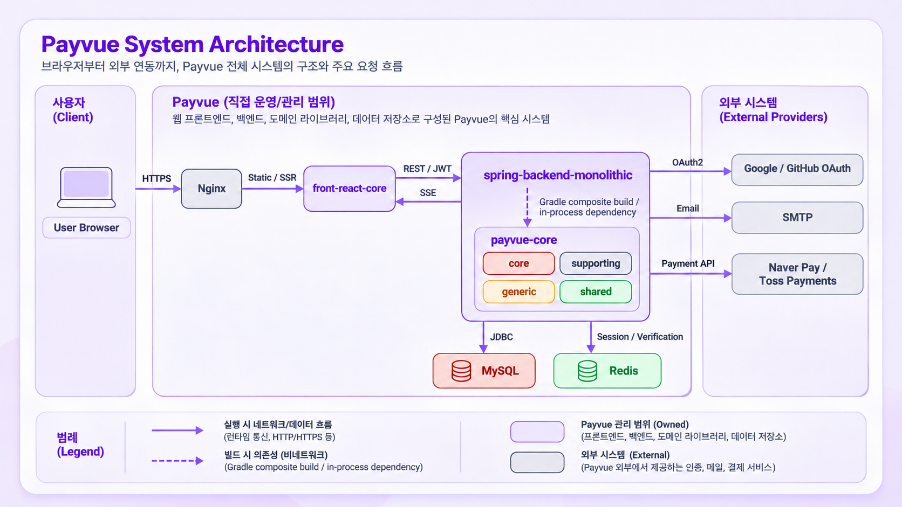
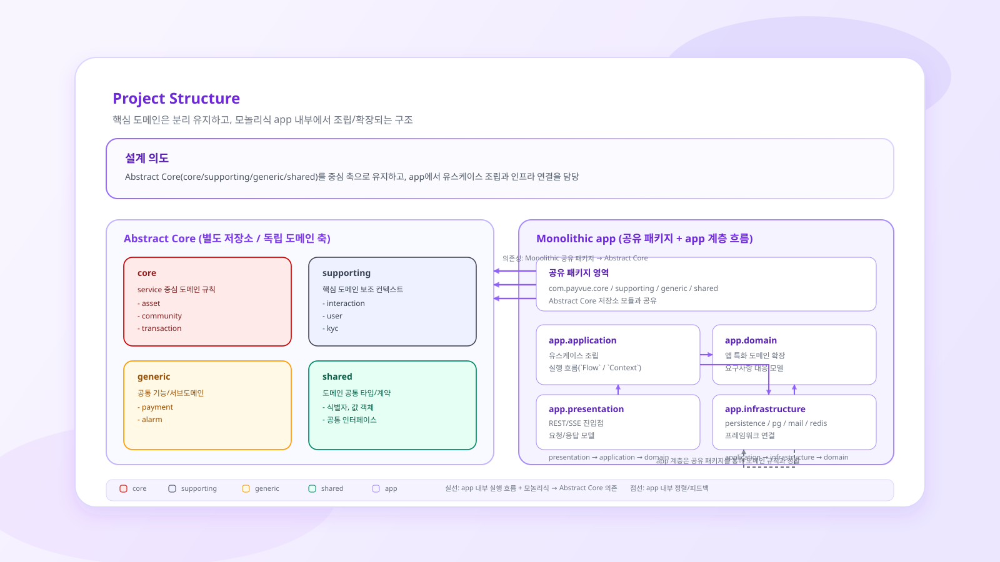
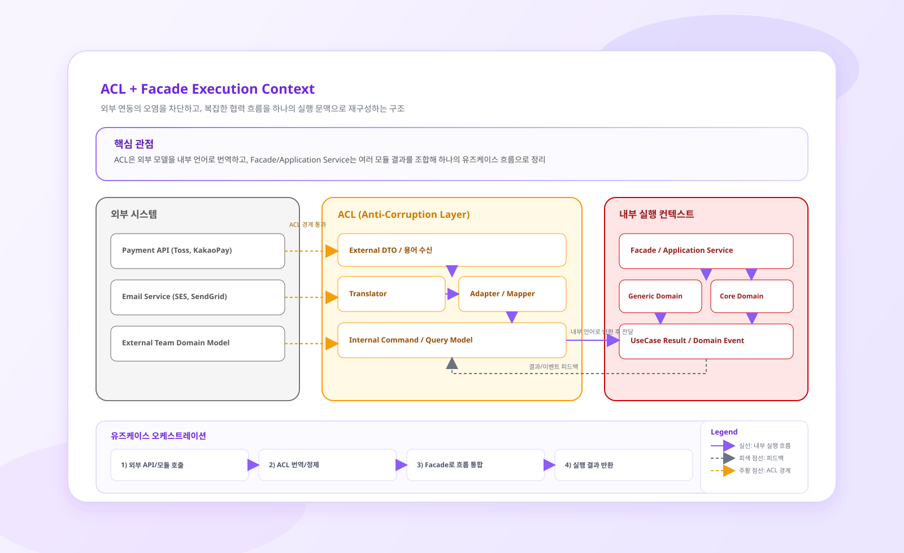
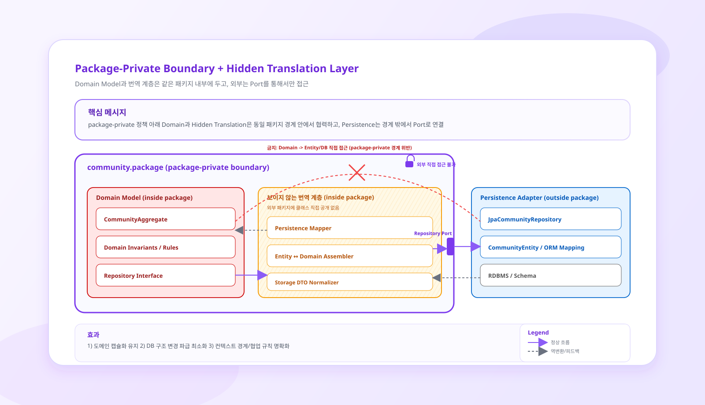
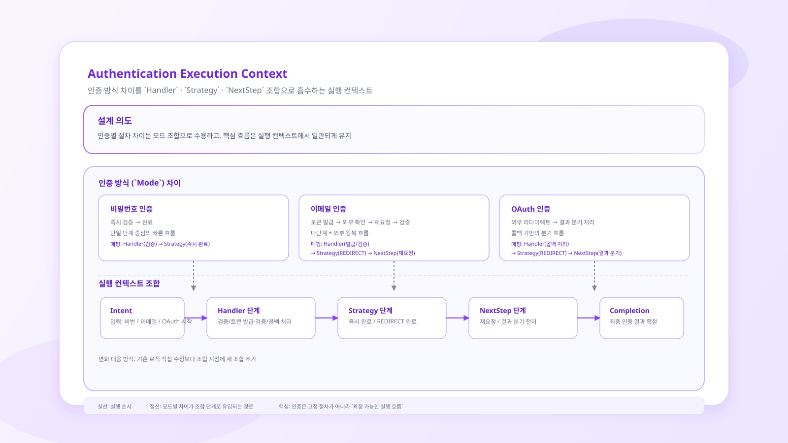

# spring-backend-monolithic

Payvue의 도메인 모델을 실제 HTTP API, 인증, 영속성, 외부 결제, 알림 흐름으로 조립하는 Spring Boot 모놀리식 애플리케이션입니다.

[`payvue-core`](https://github.com/payvue/payvue-core)가 재사용 가능한 애그리게이트·정책·포트를 소유한다면, 이 저장소는 그 모델을 가져와 애플리케이션별 유스케이스와 기술 어댑터를 완성합니다. 따라서 핵심 규칙과 애플리케이션 실행 로직, 외부 시스템 연동 코드가 서로 다른 변경 이유를 유지하도록 경계를 나누는 것이 이 프로젝트의 중심 설계 원칙입니다.

> 현재 버전: `0.0.1-SNAPSHOT` · Java 21 · Spring Boot 3.2.5 · Gradle 8.13

## 아키텍처 개요



| 요소 | 책임 | 주요 연결 |
| --- | --- | --- |
| User Browser | Payvue 화면을 실행하고 사용자 입력을 전달 | Nginx에 HTTPS 요청 |
| Nginx | 프론트엔드 전달을 담당하는 edge/reverse proxy 배치 지점 | Next.js 정적 자원 또는 SSR 응답 전달 |
| `front-react-core` | 화면, 클라이언트 상태, REST API와 SSE 클라이언트 | 백엔드에 Bearer JWT 요청, SSE 알림 수신 |
| `spring-backend-monolithic` | REST/SSE 진입점, 유스케이스 조립, 보안, 트랜잭션, 외부 어댑터 | core 모듈·MySQL·Redis·OAuth·SMTP·PG 연결 |
| `payvue-core` | 프레임워크와 독립적인 도메인 모델, 정책, 포트 | Gradle composite build로 백엔드 프로세스에 포함 |
| MySQL | 사용자·커뮤니티·보유 자산·거래·결제의 영속 상태 | Spring Data JPA/JDBC |
| Redis | 활성 세션과 이메일 검증 토큰 | Spring Data Redis |
| 외부 공급자 | OAuth 인증, 이메일 전송, 결제 예약·승인 | OAuth2, SMTP, HTTPS Payment API |

실선은 실행 중 발생하는 네트워크 또는 데이터 흐름을 나타냅니다. 점선은 배포된 서비스 사이의 호출이 아니라 빌드 시 결정되는 의존성을 뜻합니다. 따라서 `payvue-core`는 독립 서버가 아니며 `spring-backend-monolithic` 안에서 같은 프로세스로 실행됩니다.

### 대표 실행 흐름

1. 브라우저는 Nginx를 통해 `front-react-core`를 로드하고, 프론트엔드는 백엔드 REST API에 JWT를 포함해 요청합니다.
2. 백엔드는 Controller에서 요청을 받아 `ApplicationService → Flow/Context → payvue-core` 순서로 유스케이스를 실행합니다.
3. 영속 상태는 MySQL에, 활성 세션과 검증 토큰은 Redis에 저장합니다.
4. OAuth·메일·결제가 필요한 흐름은 내부 포트를 거쳐 Google/GitHub, SMTP, Naver Pay/Toss Payments 어댑터로 전달됩니다.
5. 거래·초대·시스템 알림은 백엔드가 SSE로 전송하고, 프론트엔드는 관련 Query 캐시를 갱신해 최신 상태를 다시 조회합니다.

## 프로젝트 경계



| `payvue-core` | `spring-backend-monolithic` |
| --- | --- |
| `Community`, `Holdings`, `Transaction`, `Interaction`, `Payment` 등 도메인 모델 | 개인·협동·시스템 커뮤니티, 구체 자산 종류, 인증처럼 애플리케이션에 특화된 모델 |
| 불변식, 정책, 명세, 상태 전이 | `ApplicationService`와 `*Flow`가 구성하는 유스케이스 순서와 트랜잭션 경계 |
| `Repository`, `Gateway`, `Translator`, `AlarmChannel` 등의 계약 | JPA·Redis·WebClient·SMTP·SSE를 이용한 계약 구현 |
| 프레임워크와 독립적인 도메인 코드 | Spring MVC, Security, OAuth2, JPA 및 환경 설정 |

Gradle의 composite build가 `com.payvue:*` 모듈 의존성을 로컬 `payvue-core` 프로젝트로 치환합니다. 애플리케이션 코드는 core 모델을 복제하지 않고, 필요한 구체 타입과 조립 코드만 이 저장소에 둡니다.

## 요청 처리 구조

```text
REST / SSE 요청
    ↓
Controller
    ↓
ApplicationService
    ↓
Use-case Flow + Context
    ↓
Domain model / ContextManager / Repository·Gateway port
    ↓
JPA · Redis · PG · Mail · Security adapter
```

`ApplicationService`는 HTTP 요청을 직접 처리하지 않고 유스케이스의 진입점 역할을 합니다. 실제 절차는 `PaymentRequestApproveFlow`, `TransferCashFlow`, `PayReserveFlow`와 같은 명시적인 흐름 객체가 실행 컨텍스트에 상태를 축적하며 진행합니다.

예를 들어 결제 요청 승인 흐름은 요청과 커뮤니티를 조회하고, 요청자와 승인자를 식별한 뒤 `InteractionExecutor`로 판단을 실행하고 알림을 전송합니다. 현금 송금 흐름은 멱등성 확인, 사용자·커뮤니티·보유 자산 조회, 상호작용 승인, 거래 저장, 알림 전송을 하나의 유스케이스로 조립합니다. 각 단계가 어떤 컨텍스트를 필요로 하는지 코드에서 읽히게 하는 것이 `*Flow` 패턴의 목적입니다.

## 주요 애플리케이션 영역

| 영역 | 제공하는 흐름 |
| --- | --- |
| Account | 계정 생성·수정·조회, 비밀번호 변경, 결제 한도 설정 |
| Auth | 비밀번호 로그인, 로그아웃, 이메일 검증, 계정·비밀번호 복구, OAuth2 |
| Community | 커뮤니티 생성·초대·참여, 결제 요청 생성·승인·거절 |
| Asset | 온라인 자산 생성, 잔액·보유 자산 요약, 결제 수단 조회 |
| Transaction | 현금·자산 송금, 거래 저장, 개인·커뮤니티 거래 내역 조회 |
| Payment | Naver Pay 단건 결제, Toss 가상계좌 예약·승인·취소 |
| Alarm | 이메일 알림, 인앱 알림, SSE 구독과 읽음 처리 |
| Summary | 자산 잔액의 카테고리별 집계 |

## 컨텍스트 경계와 협력

### 외부 모델은 내부 언어로 번역합니다



결제 사업자, 메일 서버, OAuth 공급자가 사용하는 DTO와 용어는 Payvue의 도메인 언어와 다릅니다. 외부 응답을 애플리케이션 전역으로 전달하면 사업자별 필드와 상태 코드가 유스케이스와 도메인 모델을 오염시키므로, 이 프로젝트는 계약·어댑터·번역기를 경계에 배치합니다.

#### 결제 ACL

`payvue-core`의 `PaymentGateway`는 외부 호출 계약을, `PaymentTranslator`는 외부 응답을 내부 `Payment`로 변환하는 계약을 정의합니다. 이 저장소는 다음 구현으로 그 계약을 완성합니다.

| 경계 역할 | 현재 구현 |
| --- | --- |
| 외부 호출 | `NaverPaymentGateway`, `VirtualAccountTossGateway`가 `WebClient`로 PG API 호출 |
| 외부 응답 | `NaverPaymentResponse`, `TossVirtualAccountResponse` 등 사업자별 모델 |
| 내부 번역 | `NaverPaymentTranslator`, `TossPaymentTranslator`가 외부 상태·식별자·메타데이터를 `Payment`로 변환 |
| 실행 전략 | `PaymentMode`가 단건·가상계좌 등 결제 방식의 행위를 표현 |
| 조립 | `PaymentConfiguration`이 제공자와 모드에 맞는 Gateway·Translator·Dispatcher를 `PaymentSupportRegistry`에 등록 |
| 유스케이스 | `PaymentService`와 `PayReserveFlow`가 예약·승인 결과를 애플리케이션 흐름에 연결 |

```text
Naver/Toss DTO
    → PaymentGateway
    → PaymentTranslator
    → Payment
    → PaymentService / Application Flow
```

이 구조에서 애플리케이션 서비스는 Naver나 Toss의 응답 필드를 알지 못합니다. 새로운 사업자를 추가할 때에도 기존 유스케이스를 사업자 분기문으로 수정하기보다 새로운 Gateway와 Translator를 등록하는 방식으로 확장할 수 있습니다.

#### 알림과 외부 채널

알림 역시 `AlarmChannel`이라는 내부 계약을 중심으로 구성합니다. `EmailAlarmChannel`은 `EmailSender`와 템플릿 해석기를 이용하고, `SseAlarmChannel`은 `SseEmitterRegistry`를 이용합니다. `AlarmContextConfiguration`은 채널과 예외 처리기를 등록하고, 애플리케이션 흐름은 `AlarmContextManager`에 도메인 알림을 전달할 뿐 SMTP나 SSE 구현을 알지 않습니다.

### 내부 모델은 필요한 계약만 공개합니다



도메인 객체와 데이터베이스 엔티티는 수명 주기와 제약이 다릅니다. 도메인 모델은 행위와 불변식을 표현하고, JPA 엔티티는 테이블 관계와 조회 방법을 표현합니다. 두 모델을 하나로 합치지 않고 `Repository` 포트와 패키지 내부 번역 계층을 사이에 둡니다.

| 도메인 포트 | 애플리케이션 어댑터 | 번역 계층의 책임 |
| --- | --- | --- |
| `CommunityRepository` | `JpaCommunityRepository` | `CommunityEntityMapper`가 Personal·Cooperative·System 모델과 참여자·역할을 JPA 구조로 변환 |
| `HoldingsRepository` | `JpaHoldingsRepository` | `AssetItemMapper`와 `AssetCharacteristicMapper`가 자산 종류·상태·수행 능력을 복원 |
| `TransactionRepository` | `JpaTransactionRepository` | `TransactionEntityMapper`가 커뮤니티와 보유 자산을 조회해 거래 애그리게이트를 재구성 |
| `CommunityRelationRepository` | `JpaCommunityRelationRepository` | `CommunityRelationMapper`가 관계 유형과 연결 상태를 변환 |
| `PaymentRepository` | `JpaPaymentRepository` | `JsonMapConverter`를 포함해 결제 상태와 메타데이터를 저장 구조로 변환 |
| `VerificationTokenRepository` | `RedisVerificationTokenRepository` | 검증 토큰을 Redis 키·직렬화 형식과 도메인 모델 사이에서 변환 |

JPA 엔티티와 Spring Data 인터페이스는 `infrastructure.persistence` 안에 머물고 core 모델에는 JPA 어노테이션을 추가하지 않습니다. 현재 일부 Mapper는 식별자와 캡슐화된 상태를 복원하기 위해 reflection을 사용하지만, 그 구현 세부사항 역시 번역 계층 밖으로 노출하지 않습니다.

또한 `com.payvue.core.*`, `com.payvue.supporting.*`, `com.payvue.generic.*` 아래의 Spring Configuration은 core 모듈의 패키지 내부 확장 지점과 애플리케이션 구현을 연결합니다. 예를 들어 `CommunityContextConfiguration`은 Personal·Cooperative 구현과 역할 카탈로그를 등록하고, `TransactionConfiguration`은 자산 종류와 거래 유형별 핸들러를 바인딩합니다. 이는 도메인 모델을 Spring에 종속시키는 대신 소비 애플리케이션이 조립 책임을 갖게 하는 경계입니다.

## 인증 컨텍스트 모델링



비밀번호, 이메일, OAuth2는 모두 사용자의 신원을 확인하지만 실행 절차와 완료 결과가 다릅니다. 비밀번호 인증은 자격 증명을 즉시 검증하고 세션을 발급할 수 있지만, 이메일 인증은 토큰 발급과 외부 확인 후 검증이라는 두 단계를 거칩니다. OAuth2는 외부 공급자의 인증과 callback 결과에 따라 리다이렉트 또는 즉시 완료를 선택해야 합니다. 이 차이를 인증 방식별 거대한 조건문으로 만들지 않고 `Handler → CompletionStrategy → NextStep` 조합으로 표현합니다.

| 구성 요소 | 현재 구현과 책임 |
| --- | --- |
| `Authentication` | `NONE`, `PASSWORD`, `EMAIL`, `OAUTH2` 중 실행할 인증 단위를 식별 |
| `AuthRequest` | 이메일·비밀번호·검증 토큰·OAuth principal을 `identifier`, `secret`, `purpose`라는 내부 입력으로 정규화 |
| `AuthSequenceHandler` | `NoneAuthVerifier`, `PasswordAuthVerifier`, `EmailTokenIssuer`, `EmailTokenVerifier`, `OAuthAuthVerifier`가 발급 또는 검증 한 단계를 수행 |
| `CompletionStrategy` | `DIRECT`, `REDIRECT`, `OAUTH_DYNAMIC`에 맞는 완료 결과 매칭 |
| `NextStep` | `AuthenticateComplete`, `RedirectRequired`, `SequenceByNextStep`이 세션 확정 또는 추가 인증 같은 후속 단계를 결정 |
| `SessionManager` | 검증 성공 시 JWT 세션을 발급하고 활성 access token을 Redis에 저장하며, 로그아웃·실패 시 세션을 중단 |
| `AuthContextManager` | 인증 방식·완료 전략·실행 단계에 맞는 `AuthOrchestrator`를 찾아 애플리케이션 Flow에 단일 진입점을 제공 |

```text
Application Flow
    → AuthContextManager.authenticate(type, strategy, sequence, request)
    → AuthOrchestrator
    → AuthSequenceHandler (토큰 발급 / 인증 검증)
    → SessionManager
    → CompletionStrategy
    → NextStep
    → AuthCompletion
```

`AuthContextConfiguration`은 위 조합을 실행 가능한 객체 그래프로 등록합니다.

| 인증 단위 | Handler | 완료와 후속 단계 | 사용 위치 |
| --- | --- | --- | --- |
| `PASSWORD + DIRECT` | `PasswordAuthVerifier`가 BCrypt 기반 비밀번호 검증 | `DirectCompletion → AuthenticateComplete` | `BasicLoginFlow` |
| `EMAIL + REDIRECT` | `EmailTokenIssuer` 또는 `EmailTokenVerifier`가 검증 토큰 발급·확인 | 발급은 `RedirectRequired`, 검증 성공은 세션 확정 흐름으로 연결 | 회원가입, 이메일 재발송, 아이디·비밀번호 복구 Flow |
| `OAUTH2 + OAUTH_DYNAMIC` | `OAuthAuthVerifier`가 공급자 principal과 내부 사용자를 연결 | 실패는 리다이렉트, 성공은 직접 완료 후 `AuthenticateComplete` | Spring Security OAuth2 성공 처리 |
| `NONE + DIRECT` | `NoneAuthVerifier`가 실패 결과를 반환해 `AuthOrchestrator`의 세션 중단 경로를 활성화 | `DirectCompletion`으로 종료 | `BasicLogoutFlow`, 비밀번호 변경 후 세션 정리 |

핵심은 인증 방식과 애플리케이션 시나리오를 분리하는 것입니다. `BasicLoginFlow`, `AccountCreationFlow`, 계정 복구·검증 Flow는 어떤 Handler를 직접 생성하지 않고 `AuthContextManager`에 의도를 전달합니다. 반대로 인증 컨텍스트는 HTTP Controller나 화면 전환 순서를 알지 못합니다. 인증 방식이 추가되면 기존 유스케이스의 분기문을 확장하기보다 `AuthContextConfiguration`의 조립 지점에 Handler·Strategy·NextStep 조합을 등록할 수 있습니다.

## 실행 컨텍스트 조립

| 구성 | 조립하는 내용 |
| --- | --- |
| `AuthContextConfiguration` | NONE·PASSWORD·EMAIL·OAUTH2 인증별 Handler, 완료 Strategy, NextStep |
| `CommunityContextConfiguration` | Personal·Cooperative 커뮤니티 구현, 초기화 규칙, 역할 카탈로그 |
| `InteractionConfiguration` | management·payment·payment-request·transfer 흐름과 핸들러 체인 |
| `AssetCharacteristicConfiguration` | 잔액·소모성·획득 가능 자산의 명령과 Capability Handler |
| `TransactionConfiguration` | 자산 종류와 거래 유형별 Handler, 수수료 정책과 Decorator |
| `PaymentConfiguration` | PG 제공자와 결제 모드별 Gateway, Translator, Dispatcher |
| `AlarmContextConfiguration` | 이메일·인앱 채널, Repository와 실패 처리기 |
| `UserContextConfiguration` | 사용자 명령·조회 Repository, 비밀번호 정책과 기본 환경 설정 |

Configuration은 실행 가능한 객체 그래프를 만들지만, 도메인 규칙 자체를 소유하지 않습니다. 규칙은 모델과 정책 객체에 남기고 Configuration은 어떤 구현을 어떤 컨텍스트에 사용할지만 결정합니다.

## 패키지 구조

```text
src/main/java/com/payvue
├── app
│   ├── application       # ApplicationService, UseCase, 단계별 Flow와 Context
│   ├── domain            # 이 애플리케이션에 특화된 모델과 core 확장 구현
│   ├── infrastructure    # JPA, Redis, PG, Mail, Security, SSE 어댑터
│   └── presentation      # REST Controller, 요청/응답 DTO, SSE endpoint
├── core                  # core 모듈의 애플리케이션별 Spring 조립
├── supporting            # supporting context 조립과 확장
└── generic               # payment·alarm context 조립
```

## 기술 스택

- Java 21, Kotlin 1.9.24, Gradle 8.13
- Spring Boot 3.2.5, Spring MVC, Validation, AOP
- Spring Security, OAuth2 Client, JWT
- Spring Data JPA, MySQL, MapStruct
- Spring Data Redis
- WebClient 기반 PG 연동
- Spring Mail, Thymeleaf, Server-Sent Events
- JUnit 5, Spring Boot Test, Kotest, Testcontainers, MockWebServer

## 로컬 실행

### 1. 요구 사항

- JDK 21
- MySQL
- Redis
- 로컬에 체크아웃한 [`payvue-core`](https://github.com/payvue/payvue-core)
- 이메일·OAuth·PG 기능을 사용할 경우 각 공급자의 테스트 자격 증명

### 2. `payvue-core` 연결

현재 `settings.gradle`의 `includeBuild`와 `.gitmodules`에는 개발자 로컬 절대 경로가 남아 있습니다. 빌드 전에 `payvue-core`를 별도로 체크아웃하고 `includeBuild` 경로를 자신의 환경에 맞게 수정해야 합니다. 두 저장소를 형제 디렉터리에 두었다면 다음과 같이 연결할 수 있습니다.

```groovy
includeBuild('../payvue-core') {
  // 기존 dependencySubstitution 설정 유지
}
```

> 이 경로를 수정하기 전에는 Gradle이 포함 빌드를 찾지 못해 실행되지 않습니다.

### 3. 애플리케이션 설정

`src/main/resources/application.yml`에서 다음 설정 그룹을 로컬 환경 또는 안전한 외부 설정으로 제공합니다.

- `spring.datasource.*`: MySQL 연결
- `spring.data.redis.*`: Redis 연결
- `spring.mail.*`: SMTP 연결
- `spring.security.oauth2.client.*`: Google·GitHub OAuth2
- `security.jwt.*`: JWT issuer, TTL, secret
- `payment.pg.naver.*`, `payment.pg.toss.*`: PG endpoint와 자격 증명
- `app.verification.*`: 이메일 검증 URL과 만료 시간

현재 설정이 참조하는 주요 환경 변수는 다음과 같습니다.

```text
GITHUB_CLIENT_ID
GITHUB_CLIENT_SECRET
GOOGLE_CLIENT_ID
GOOGLE_CLIENT_SECRET
JWT_SECRET
MAIL_FROM
MAIL_FROM_NAME
MAIL_PASSWORD
MAIL_USERNAME
REDIS_HOST
REDIS_PORT
VERIFICATION_BASE_URL
```

### 4. 실행과 테스트

```bash
./gradlew bootRun
./gradlew test
```

테스트는 애플리케이션 Flow와 도메인 조립뿐 아니라 JPA Mapper·Repository, Redis 저장소, PG Gateway·Translator, Security, Mail, SSE 어댑터까지 검증합니다. Redis·MySQL 같은 외부 의존성을 사용하는 테스트는 로컬 서비스나 Testcontainers 실행 환경이 필요할 수 있습니다.

## 설계 자료 출처

프로젝트 경계, 인증 실행 컨텍스트, ACL, 패키지 경계 다이어그램은 [`payvue/front-react-core`](https://github.com/payvue/front-react-core)의 블로그 `[설계] Core`, `[구현] DDD`에서 사용한 시각 자료와 [`payvue-core`](https://github.com/payvue/payvue-core)의 프로젝트 경계 설명을 현재 애플리케이션 코드에 맞춰 사용했습니다. 원본 자료를 확인한 기준 리비전은 [`e6b1803`](https://github.com/payvue/front-react-core/commit/e6b1803deeb42900a868a9c63f4fc5639014f0d5)입니다.

전체 시스템 아키텍처 이미지는 C4의 다이어그램 원칙과 이 저장소의 API·SSE·JPA·Redis·OAuth2·SMTP·PG 구현을 기준으로 새로 작성했습니다. Nginx는 코드에 포함된 현재 구현이 아니라 선택 가능한 배포 경계로 구분했습니다.

다이어그램은 설계 의도를 설명하고, 현재 코드 구조에 대한 최종 기준은 이 저장소와 `payvue-core`의 실제 소스입니다.
